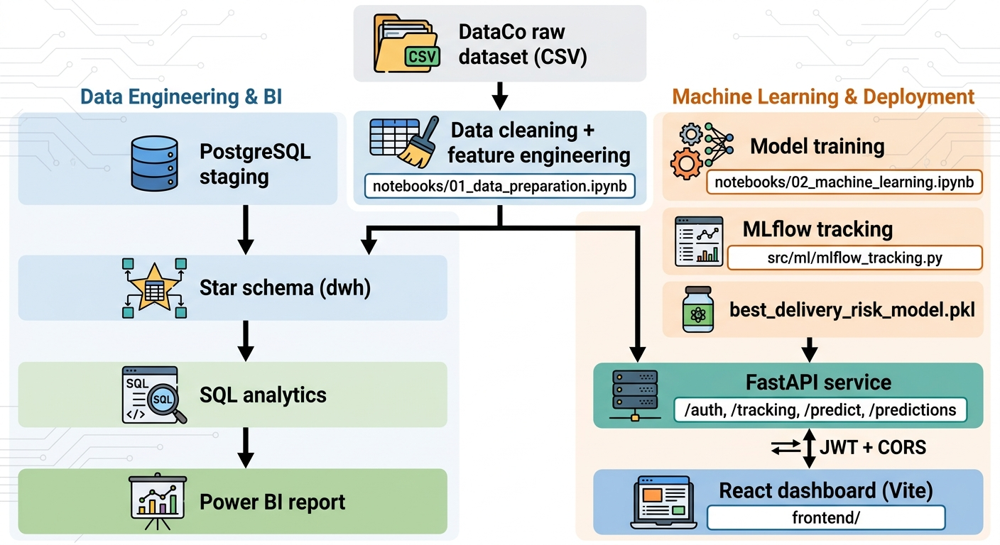
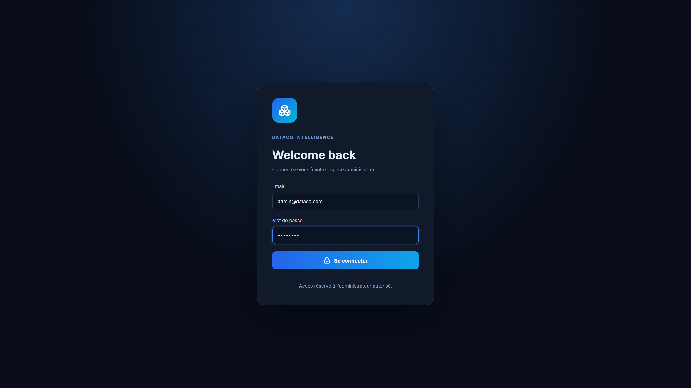
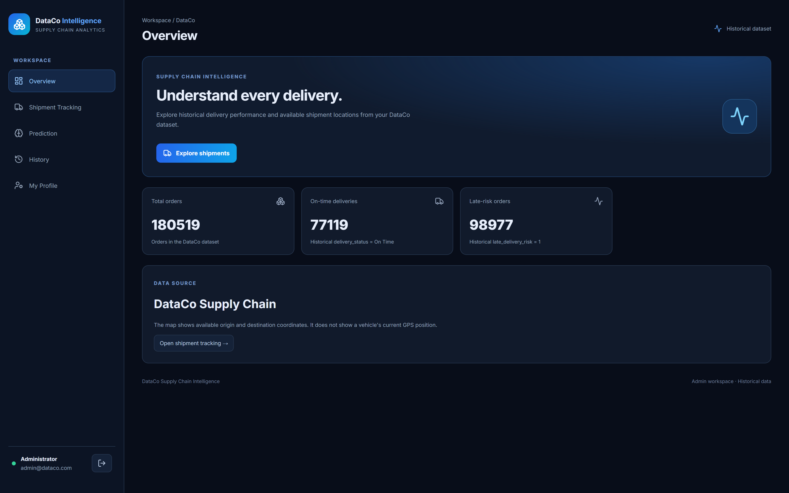
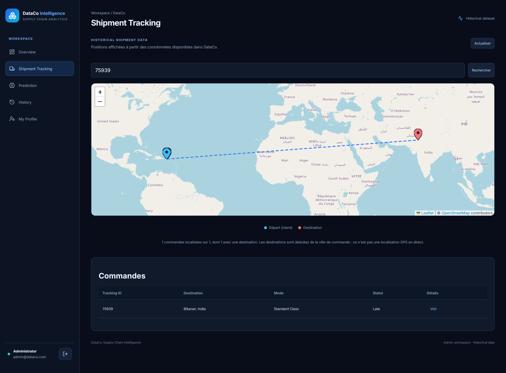
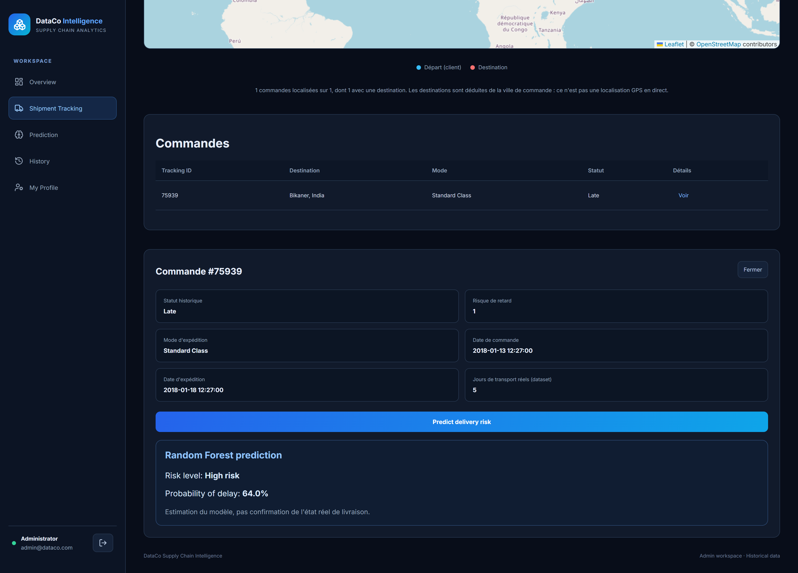
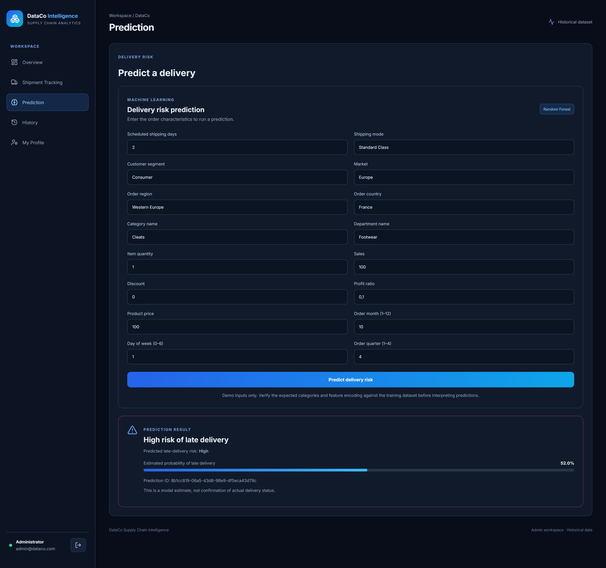
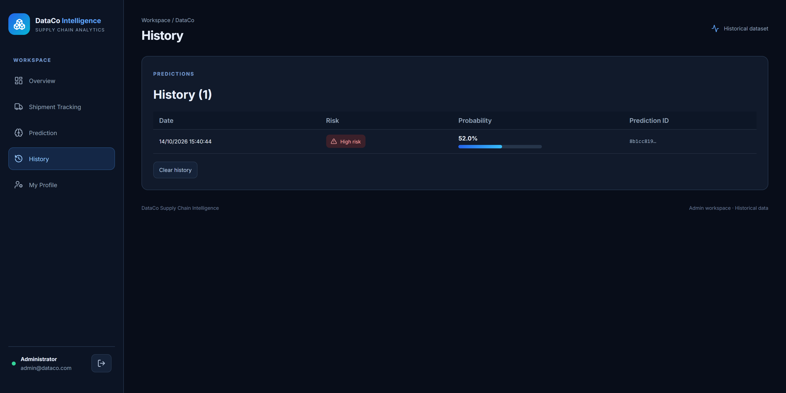
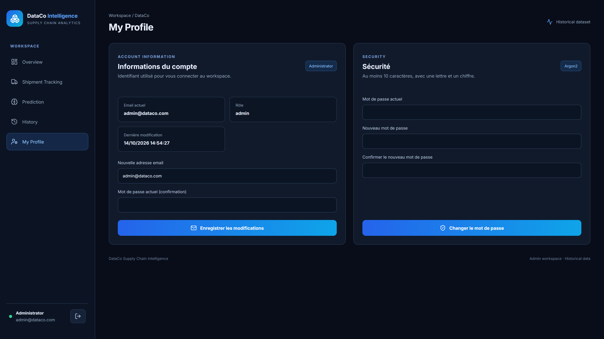
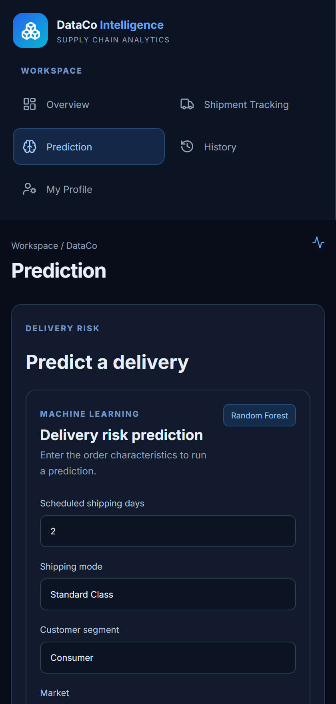

# 📦 DataCo Supply Chain Intelligence

**An end-to-end supply chain analytics platform** — from raw data to a dimensional warehouse, BI dashboards, a trained delivery-risk model, and a secured web application that serves predictions to business users.


---

## 📑 Table of contents

1. [Project overview](#-project-overview)
2. [Architecture](#-architecture)
3. [Technologies](#-technologies)
4. [Project structure](#-project-structure)
5. [Machine learning](#-machine-learning)
6. [PostgreSQL data warehouse](#-postgresql-data-warehouse)
7. [Power BI report](#-power-bi-report)
8. [API reference](#-api-reference)
9. [Security](#-security)
10. [Getting started](#-getting-started)
11. [Testing](#-testing)
12. [Application walkthrough](#-application-walkthrough)
13. [Scope and limitations](#-scope-and-limitations)
14. [Roadmap](#-roadmap)
15. [Author](#-author)

---

## 🎯 Project overview

DataCo Supply Chain Intelligence analyses **180 519 order-item records** from the DataCo Smart Supply Chain dataset to answer one operational question: **which deliveries are at risk of being late, and why?**

The project covers the full chain, from raw CSV to a usable business interface:

| Layer | What it does |
| --- | --- |
| **Data engineering** | Cleaning, feature engineering, loading into a PostgreSQL star schema |
| **Analytics / BI** | SQL analytics on the warehouse + a three-page Power BI report |
| **Machine learning** | A Random Forest pipeline predicting `late_delivery_risk`, tracked in MLflow |
| **API** | A FastAPI service exposing predictions, shipment tracking, and JWT-protected admin endpoints |
| **Web application** | A React dashboard where an administrator searches shipments, runs predictions, and manages their account |

### Business objectives

- Analyse sales and order performance across regions, markets, and shipping modes.
- Identify where delivery delays concentrate.
- Score an individual order's probability of late delivery **before it ships**.
- Give business stakeholders an interface that does not require a notebook.

### Key figures

| | |
| --- | --- |
| Order-item records analysed | **180 519** |
| On-time deliveries | **77 119** |
| Orders flagged at risk (`late_delivery_risk = 1`) | **98 977** |
| Model features | **16** |
| Model ROC-AUC on held-out test set | **0.762** |
| Automated tests | **29**, all passing |

### Dataset

**DataCo Smart Supply Chain for Big Data Analysis** — order-level and product-level records containing orders and customers, products and categories, sales, discounts and profitability, shipping modes and scheduled delivery times, geographic information, actual shipping duration, and a delivery risk indicator used as the ML target.

> One order can contain several items: the dataset grain is the **order item**, and so is the fact table grain.

---

## 🏗️ Architecture



The same processed dataset feeds two independent branches:

- **Data Engineering & BI** — loaded into PostgreSQL staging, modelled as a star schema, queried through SQL analytics, and surfaced in Power BI.
- **Machine Learning & Deployment** — used to train the Random Forest, tracked in MLflow, serialised to a pipeline, and served by FastAPI to the React dashboard.

### Request flow

1. The React client authenticates against `POST /auth/login` and stores a short-lived JWT in `sessionStorage`.
2. Every subsequent call carries that token; the API verifies the signature **and** a version claim before serving any data.
3. Tracking endpoints read the processed CSV and enrich destinations through a disk-cached geocoder.
4. Prediction endpoints load the serialised scikit-learn pipeline once at startup and score requests against it, persisting each result server-side.

---

## 🛠️ Technologies

| Category | Stack |
| --- | --- |
| **Language** | Python 3.14, JavaScript (ES2022) |
| **Data processing** | pandas, NumPy |
| **Database** | PostgreSQL, SQLAlchemy, psycopg2 |
| **Warehouse** | SQL, star schema (5 dimensions + 1 fact) |
| **BI** | Power BI, DAX |
| **Machine learning** | scikit-learn (`Pipeline`, `ColumnTransformer`, `RandomForestClassifier`), joblib |
| **Experiment tracking** | MLflow (SQLite backend + local artifact store) |
| **API** | FastAPI, Pydantic v2, Uvicorn |
| **Authentication** | JWT (python-jose), Argon2id hashing (pwdlib) |
| **Frontend** | React 19, Vite 8, React Router 7, Leaflet / react-leaflet, Recharts, lucide-react |
| **Geocoding** | OpenStreetMap Nominatim, disk-cached |
| **Testing** | pytest, FastAPI TestClient |

---

## 📁 Project structure

```text
DataCo-Supply-Chain/
│
├── data/                              # gitignored — see "Getting the data"
│   ├── raw/DataCoSupplyChainDataset.csv
│   └── processed/DataCo_featured.csv
│
├── notebooks/
│   ├── 01_data_preparation.ipynb      # cleaning, feature engineering
│   ├── 02_machine_learning.ipynb      # model comparison and training
│   └── report.html                    # profiling report (gitignored)
│
├── src/
│   ├── api/
│   │   ├── main.py                    # app, CORS, /predict, /predictions, /health
│   │   ├── schemas.py                 # DeliveryFeatures — the 16 model inputs
│   │   ├── security.py                # JWT issue/verify, token versioning
│   │   ├── accounts.py                # persistent admin account, Argon2 hashing
│   │   ├── history.py                 # prediction history storage
│   │   ├── geo.py                     # destination geocoding + disk cache
│   │   └── routes/
│   │       ├── auth.py                # login, profile, password change
│   │       ├── tracking.py            # summary, shipment search and detail
│   │       └── predictions.py         # scoring an existing order by ID
│   │
│   ├── ml/mlflow_tracking.py          # experiment logging
│   └── postgres/                      # 19 scripts: schema, loading, DWH, validation
│
├── frontend/
│   ├── src/
│   │   ├── App.jsx                    # shell, routing, session guard
│   │   ├── main.jsx
│   │   ├── index.css                  # design system (dark navy / electric blue)
│   │   ├── pages/                     # login, overview, LiveTracking,
│   │   │                              # prediction, history, profile
│   │   ├── components/                # PredictionForm, PredictionResult, …
│   │   └── services/api.js            # fetch wrapper, token handling
│   ├── index.html
│   └── package.json
│
├── tests/
│   ├── conftest.py                    # isolated fixtures, network disabled
│   ├── test_auth.py                   # 16 auth and profile tests
│   ├── test_predictions.py            # prediction schema and history
│   └── test_tracking.py               # tracking endpoints
│
├── models/best_delivery_risk_model.pkl   # gitignored (731 MB)
├── powerbi/dataco_supply_chain.pbix
├── screenshots/
├── storage/                           # gitignored — runtime state
├── .env.example
├── requirements.txt
└── README.md
```

---

## 🤖 Machine learning

### Problem

Binary classification of `late_delivery_risk` (1 = at risk of late delivery), trained on 144 415 rows and evaluated on 36 104 (80/20 split, `random_state=42`).

### Pipeline

A single scikit-learn `Pipeline` is serialised, so preprocessing and model always travel together:

```
Pipeline
 ├── preprocessor : ColumnTransformer   (encodes the 7 categorical features,
 │                                       passes the 9 numeric ones through)
 └── model        : RandomForestClassifier(n_estimators=100, max_depth=None,
                                           random_state=42)
```

### The 16 features

| Numeric | Categorical |
| --- | --- |
| `days_for_shipment_scheduled` | `shipping_mode` |
| `order_item_quantity` | `customer_segment` |
| `sales` | `market` |
| `order_item_discount` | `order_region` |
| `order_item_profit_ratio` | `order_country` |
| `product_price` | `category_name` |
| `order_month` | `department_name` |
| `order_day_of_week` | |
| `order_quarter` | |

**Leakage prevention:** features revealing the actual outcome — `days_for_shipping_real`, `delivery_delay`, `delivery_status`, `delay_category` — are deliberately excluded from the inputs.

### Results

Models compared: Logistic Regression, Decision Tree, Random Forest, XGBoost. Random Forest was selected. Metrics logged to MLflow on the held-out test set:

| Metric | Value |
| --- | --- |
| Accuracy | **0.696** |
| Precision | **0.756** |
| Recall | **0.660** |
| F1-score | **0.705** |
| ROC-AUC | **0.762** |

> These are honest numbers for a problem where scheduling data alone explains only part of the delay. Precision above recall means the model is relatively trustworthy when it flags an order, at the cost of missing some late deliveries. Treat its output as a risk indicator, not a verdict.

### Experiment tracking

Runs, parameters, metrics, and artifacts are logged to MLflow (`mlflow.db` + `mlruns/`) under the experiment **RandomForest-Delivery-Risk**:

```bash
mlflow ui --backend-store-uri sqlite:///mlflow.db
```

---

## 🗄️ PostgreSQL data warehouse

`staging.orders` holds the prepared dataset; the analytical model is a star schema whose fact grain is **one row per order item**.

```text
                  dim_date
                     │
dim_customer ─── fact_orders ─── dim_product
                     │
              ┌──────┴──────┐
              ▼             ▼
        dim_shipping   dim_location
```

| Table | Content |
| --- | --- |
| `staging.orders` | Prepared source dataset |
| `dwh.dim_date` | Date attributes |
| `dwh.dim_customer` | Customer information |
| `dwh.dim_product` | Products and categories |
| `dwh.dim_shipping` | Shipping modes, scheduled times |
| `dwh.dim_location` | Geography and markets |
| `dwh.fact_orders` | Order-item measures and delivery indicators |

SQL analytics cover sales volumes, profitability, delivery risk and average delay, performance by region and shipping mode, monthly trends, category performance, and customer contribution.

---

## 📊 Power BI report

Three pages, with slicers on year, region, market, and shipping mode.

| Page | Content |
| --- | --- |
| **Overview** | Total sales, orders, quantity, late delivery rate, average delay, sales trend by year, sales by region, shipping mode performance |
| **Supply Chain Analysis** | Late delivery rate by region and country, average delay by shipping mode, monthly delivery risk, orders by risk |
| **Product & Customer Analysis** | Top 10 products, sales by category and segment, top 10 customers, profit by category |

---

## 🔌 API reference

Base URL: `http://127.0.0.1:8000` · Interactive docs: `/docs`

### Authentication

| Method | Endpoint | Auth | Description |
| --- | --- | --- | --- |
| `POST` | `/auth/login` | — | Form login (`username`, `password`), returns a bearer token |
| `GET` | `/auth/me` | ✅ | Current profile (email, role, last update) |
| `PATCH` | `/auth/me` | ✅ | Change email — requires the current password, returns a fresh token |
| `POST` | `/auth/change-password` | ✅ | Change password — invalidates all other sessions |

### Predictions

| Method | Endpoint | Auth | Description |
| --- | --- | --- | --- |
| `POST` | `/predict` | ✅ | Score the 16 features submitted by the form |
| `POST` | `/predictions/{tracking_id}` | ✅ | Score an existing order using its dataset values |
| `GET` | `/predictions` | ✅ | Prediction history with input features |
| `DELETE` | `/predictions` | ✅ | Clear the history |
| `GET` | `/model-info` | — | Model type, expected feature names, `predict_proba` support |
| `GET` | `/health` | — | Service status and model load state |

### Tracking

| Method | Endpoint | Auth | Description |
| --- | --- | --- | --- |
| `GET` | `/tracking/summary` | ✅ | Dataset counters and status breakdown |
| `GET` | `/tracking/shipments` | ✅ | Paginated search (`search`, `status`, `limit`, `offset`) |
| `GET` | `/tracking/shipments/{id}` | ✅ | One order, with coordinates and historical dates |
| `GET` | `/tracking/columns` | ✅ | Column names of the loaded dataset |

<details>
<summary>Example — <code>POST /predict</code></summary>

```jsonc
// Request
{
  "days_for_shipment_scheduled": 2,
  "shipping_mode": "Standard Class",
  "customer_segment": "Consumer",
  "market": "Europe",
  "order_region": "Western Europe",
  "order_country": "France",
  "category_name": "Cleats",
  "department_name": "Footwear",
  "order_item_quantity": 1,
  "sales": 100.0,
  "order_item_discount": 0.0,
  "order_item_profit_ratio": 0.1,
  "product_price": 100.0,
  "order_month": 10,
  "order_day_of_week": 1,
  "order_quarter": 4
}

// Response 200
{
  "prediction_id": "c273a95d-168e-44b6-8db1-6f8dfbcc76fa",
  "created_at": "2026-10-14T13:07:47.991676+00:00",
  "late_delivery_risk": 1,
  "risk_label": "High risk of late delivery",
  "risk_probability": 0.52
}
```
</details>

---

## 🔐 Security

- Passwords are hashed with **Argon2id** and never stored, logged, or returned in plaintext — a test asserts this against the stored file.
- JWTs are signed with HS256 using a secret of at least 32 characters, loaded from the environment and never exposed by any endpoint.
- Each token carries a **version claim**; a password change increments it, invalidating every token issued earlier.
- Changing the email or the password both require the current password, so a stolen token alone cannot take over the account.
- Email format and password policy are validated **server-side**, not only in the browser.
- All prediction, tracking, and profile endpoints require authentication.
- CORS is restricted to the origins listed in `FRONTEND_ORIGIN`.
- `.env` and `storage/` are gitignored; `.env.example` documents every variable without a single secret.

---

## ⚙️ Getting started

### Prerequisites

Python 3.11+, Node.js 20+, and (optionally) PostgreSQL 14+ for the warehouse layer.

### 1. Clone and create a virtual environment

```bash
git clone https://github.com/SoulaimaMahboubaMigaou/DataCo-Supply-Chain.git
cd DataCo-Supply-Chain

python -m venv .venv
.venv\Scripts\activate          # Windows
# source .venv/bin/activate     # macOS / Linux
```

### 2. Install dependencies

```bash
pip install -r requirements.txt
cd frontend && npm install && cd ..
```

### 3. Configure the environment

```bash
cp .env.example .env
```

Then fill in `.env`:

```ini
ADMIN_EMAIL=admin@example.com
ADMIN_PASSWORD=choose-a-strong-one-1
JWT_SECRET=<64+ random characters>
DATASET_PATH=./data/processed/DataCo_featured.csv
FRONTEND_ORIGIN=http://localhost:5173,http://127.0.0.1:5173
```

Generate a secret with:

```bash
python -c "import secrets; print(secrets.token_urlsafe(64))"
```

> `ADMIN_EMAIL` / `ADMIN_PASSWORD` **seed** the account on first start. From then on the account lives in `storage/admin_account.json` and is managed from the *My Profile* page — editing `.env` afterwards has no effect. Delete that file to re-seed.

### 4. Getting the data and the model

`data/` and `models/` are excluded from version control (the dataset files reach 102 MB and the serialised model 731 MB, above GitHub's 100 MB limit). To reproduce them:

1. Download **DataCo Smart Supply Chain for Big Data Analysis** and place `DataCoSupplyChainDataset.csv` in `data/raw/`.
2. Run `notebooks/01_data_preparation.ipynb` → produces `data/processed/DataCo_featured.csv`.
3. Run `notebooks/02_machine_learning.ipynb` → produces `models/best_delivery_risk_model.pkl` and logs the run to MLflow.

### 5. Run the application

```bash
# Terminal 1 — API (from the project root)
uvicorn src.api.main:app --reload --port 8000

# Terminal 2 — frontend
cd frontend
npm run dev
```

Open <http://localhost:5173> and sign in with the credentials from your `.env`.

### 6. Optional — PostgreSQL warehouse

Create the `dataco_supply_chain` database, then run the scripts in `src/postgres/` in order: schema creation, data loading, warehouse creation, dimension loading, fact loading, validation.

---

## ✅ Testing

```bash
python -m pytest tests -q
```

**29 tests**, all passing. The suite redirects every writable path to a temporary directory and disables network geocoding, so it never touches the real account, the saved history, or the internet.

| File | Coverage |
| --- | --- |
| `test_auth.py` | Login (valid, wrong password, unknown email, case-insensitivity), protected and forged-token routes, profile shape, email change and persistence, password policy, token invalidation, plaintext-free storage |
| `test_predictions.py` | Response schema, missing and out-of-range features, history write and clear, authentication requirement |
| `test_tracking.py` | Summary counters, search coordinates, detail fields, 404 handling |

`GET /model-info` is asserted against the request schema, so retraining with a different feature set fails the suite instead of breaking the API at runtime.

---

## 🖼️ Application walkthrough

### 1. Authentication



A single administrator account protects the workspace. Credentials are verified server-side against an **Argon2id** hash; a successful login returns a JWT valid for 30 minutes, stored in `sessionStorage`. Every protected route is rejected with `401` without a valid token.

### 2. Overview



The landing dashboard reads live counters from `GET /tracking/summary`:

| Card | Source |
| --- | --- |
| **Total orders** | Row count of the processed dataset — 180 519 |
| **On-time deliveries** | `delivery_status = "On Time"` — 77 119 |
| **Late-risk orders** | `late_delivery_risk = 1` — 98 977 |

Every figure is computed from the historical dataset at request time; nothing is hardcoded in the frontend.

### 3. Shipment Tracking



Search an order by tracking ID to plot its journey on an interactive Leaflet map.

- **Blue marker** — the customer's coordinates, read directly from the dataset (`latitude` / `longitude`).
- **Red marker** — the destination. The DataCo dataset ships **no destination coordinates**, so the order city is resolved through OpenStreetMap/Nominatim and cached on disk (`storage/geocode_cache.json`). Repeated searches are instant and work offline.
- **Dashed line** — the origin→destination link, with the map auto-fitting to the result.
- The caption states explicitly that positions are derived from historical records, **not live GPS**, and each geocoded marker is labelled as approximate.

### 4. Order details and per-order scoring



Opening an order reveals its historical record — status, shipping mode, order and shipping dates, actual transit days — and lets you run the Random Forest on **that order's real feature values** pulled from the dataset (`POST /predictions/{tracking_id}`). Here, order #75939 to Bikaner, India scores a **64.0 %** probability of delay.

### 5. Delivery risk prediction



A 16-field form mirroring exactly the features the pipeline was trained on. Submitting calls `POST /predict`, which validates the payload against the model schema, runs the pipeline, and returns:

- the predicted class (`0` / `1`),
- a readable **HIGH RISK / LOW RISK** verdict,
- the model's own probability of the positive class, rendered as a progress bar,
- a prediction ID and UTC timestamp.

The probability comes from `predict_proba` on the saved pipeline — it is never fabricated or hardcoded. Out-of-range inputs (month 13, negative sales, quantity 0…) are rejected with `422` before reaching the model.

### 6. Prediction history



Every prediction is recorded with its risk badge, probability bar, and short prediction ID. The browser keeps a local view in `localStorage`, while the API persists the authoritative record — including the full input features — in `storage/predictions.json`, readable through `GET /predictions`.

### 7. Administrator profile



Self-service account management, split into two sections:

- **Account information** — view and change the login email (current password required).
- **Security** — change the password: current password, new password, confirmation, with a policy enforced on both sides (10+ characters, at least one letter and one digit, must differ from the current one).

Changing the password increments a token version embedded in every JWT, which **invalidates all previously issued tokens** across devices; the caller receives a fresh token so their own session survives.

### 8. Responsive layout



The sidebar collapses into a two-column top navigation and every grid folds to a single column below 700 px.

---

## ⚠️ Scope and limitations

- **Shipment tracking is historical, not live.** The dataset holds past orders; no vehicle position, no delivery event is ever invented. Each response is tagged `position_type: "historical_data"`, and geocoded destinations are flagged as approximate.
- **Destination coordinates are inferred** from the order city via Nominatim, because the dataset provides none. City-level accuracy, not street-level.
- **Single administrator.** The application is built for one admin account; there is no multi-user model or role hierarchy.
- **Model performance is moderate** (ROC-AUC 0.762). The available features describe the order, not the carrier, the weather, or warehouse load.
- **The serialised model is large** (731 MB). Lowering `n_estimators` / `max_depth` or using `joblib.dump(..., compress=3)` would make it far more portable.

---

## 🔮 Roadmap

- Move prediction history from browser storage to the API for cross-device persistence.
- Containerise the API and frontend with Docker Compose.
- Add a CI pipeline (lint + pytest + build) with GitHub Actions.
- Register the model in the MLflow Model Registry and load it by stage.
- Monitor prediction drift against incoming data.

---

## 👩‍💻 Author

**Souleima Mahbouba Migaou**

Engineering student specialising in Business Intelligence, Data Analytics, and Data Science. Interested in data-driven decision-making, machine learning, analytics engineering, and MLOps.

---

*Portfolio project demonstrating data preparation, SQL and dimensional modelling, Business Intelligence, machine learning, API design, and full-stack delivery.*
